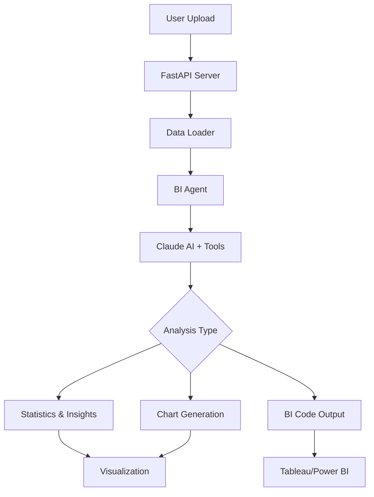
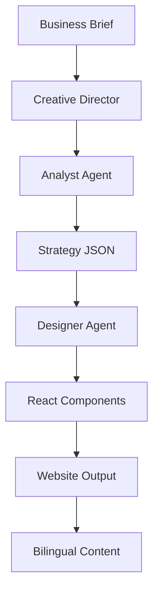

# 🚀 INTRSPOT - AI-Powered Business Intelligence Platform

[](https://www.python.org/)
[](https://reactjs.org/)
[](https://www.typescriptlang.org/)
[](LICENSE)
[]()

> **INTRSPOT** is a cutting-edge AI-powered SaaS platform that revolutionizes business intelligence and creative design. Leveraging Claude AI (Anthropic Opus 4.6), it delivers automated data analysis, stunning visualizations, and complete website generation with seamless bilingual support.

 <!-- Replace with actual banner image -->

## 📋 Table of Contents

- [✨ Features](#-features)
- [🏗️ Architecture](#️-architecture)
- [🛠️ Tech Stack](#️-tech-stack)
- [📁 Project Structure](#-project-structure)
- [🚀 Quick Start](#-quick-start)
- [📖 Usage](#-usage)
- [🤝 Contributing](#-contributing)
- [📄 License](#-license)

## ✨ Features

### 🤖 BI Agent (Data Intelligence)

| Feature | Description |
|---------|-------------|
| 🔍 **Smart Data Ingestion** | Automatically processes Excel/CSV with intelligent header detection |
| 🧠 **AI-Powered Analysis** | Generates deep insights, correlations, and statistical summaries |
| 📊 **Interactive Visualizations** | Creates 7 chart types: bar, pie, scatter, line, histogram, boxplot, heatmap |
| 💻 **BI Code Generation** | Produces Power BI DAX and Tableau calculated fields |
| 🏢 **Enterprise Integration** | Direct publishing to Tableau Server with Hyper extracts |

### 🎨 Design Agent (Creative Generation)

| Feature | Description |
|---------|-------------|
| 📝 **Strategy Generation** | Converts business briefs into comprehensive brand strategies |
| 🌐 **Website Creation** | Generates complete React/TypeScript websites from descriptions |
| 🌍 **Bilingual Output** | Full Arabic and English content generation |
| 🧩 **Component Library** | Produces reusable React components (Hero, Navbar, Services, etc.) |

### 🖥️ Platform Components

- **⚡ FastAPI Backend**: High-performance Python API for data processing
- **⚛️ React Frontends**: Modern TypeScript interfaces with Vite
- **🔗 MCP Server**: Model Context Protocol for external integrations
- **📱 Marketing Website**: Showcase landing page with animations

## 🏗️ Architecture

INTRSPOT employs a sophisticated **dual-agent architecture** orchestrated by a Creative Director:

### Data Pipeline Flow



### Design Pipeline Flow



## 🛠️ Tech Stack

### Core Technologies

- **🤖 AI Engine**: [Anthropic Claude Opus 4.6](https://www.anthropic.com/)
- **🐍 Backend**: Python 3.10+, [FastAPI](https://fastapi.tiangolo.com/), Uvicorn
- **⚛️ Frontend**: [React 19](https://reactjs.org/), [TypeScript](https://www.typescriptlang.org/), [Vite](https://vitejs.dev/)
- **🎨 Styling**: [Tailwind CSS](https://tailwindcss.com/), [Framer Motion](https://www.framer.com/motion/)

### Data & BI

- **📊 Processing**: [Pandas](https://pandas.pydata.org/), [NumPy](https://numpy.org/), [Matplotlib](https://matplotlib.org/), [Seaborn](https://seaborn.pydata.org/)
- **📈 BI Tools**: [Tableau Server API](https://help.tableau.com/current/api/rest_api/en-us/REST/rest_api.htm), [Hyper API](https://help.tableau.com/current/api/hyper_api/en-us/), Power BI
- **🔗 Integration**: Model Context Protocol (MCP)

### Development & Deployment

- **📦 Package Management**: pip, npm
- **🐳 Containerization**: Ready for Docker
- **☁️ Cloud**: AWS/Azure/GCP (deployment in progress)

## 📁 Project Structure

```
📦 Business-intelligence/
├── 🤖 bi-agent/                    # BI Analysis Service
│   ├── 🖥️ backend/                # FastAPI server & AI agents
│   │   ├── 🧠 agent.py            # BI Agent with Claude integration
│   │   ├── 🛠️ tools.py            # Claude tool definitions
│   │   ├── 📊 data_loader.py      # Smart Excel/CSV processing
│   │   └── 🖼️ tableau_publisher.py # Tableau Server integration
│   ├── 🌐 frontend/               # React dashboard (v1)
│   └── 🌐 frontend2/              # React dashboard (v2)
├── 🎨 design-agents/              # Creative Design Pipeline
│   ├── 👥 agents/                 # AI Agents (Analyst, Designer, Director)
│   └── 📤 output/                 # Generated websites & components
├── 📱 bi-platform/                # Marketing Showcase Website
│   ├── 🧩 components/             # React components (Hero, Services, etc.)
│   └── 🎯 src/                    # Main application code
├── 🔗 mcp_server/                # Model Context Protocol Server
├── 📋 generate_healthcare_report.py # Example BI implementation
├── 📊 deployment-progress.md      # Deployment status & roadmap
└── 📖 README.md                   # This file
```

## 🚀 Quick Start

### Prerequisites

- 🐍 Python 3.10 or higher
- 🟢 Node.js 18+ and npm
- 🔑 Anthropic API key
- 🖥️ Tableau Server credentials (optional)

### Installation

#### 1. Clone the Repository

```bash
git clone https://github.com/SMARTEND/Business-intelligence.git
cd Business-intelligence
```

#### 2. Backend Setup

```bash
cd bi-agent/backend
pip install -r requirements.txt

# Set environment variables
export ANTHROPIC_API_KEY="your-api-key"
export TABLEAU_SERVER_URL="your-tableau-server"
export TABLEAU_USERNAME="your-username"
export TABLEAU_PASSWORD="your-password"

# Start the server
uvicorn main:app --reload --host 0.0.0.0 --port 8000
```

#### 3. Frontend Setup

```bash
cd bi-platform
npm install
npm run dev
```

#### 4. Design Agents

```bash
cd design-agents
python run_intrspot.py
```

## 📖 Usage

### BI Analysis Workflow

1. 📤 **Upload Data**: Upload Excel/CSV files via the web interface
2. 🔍 **AI Analysis**: Claude AI analyzes data structure and generates insights
3. 📊 **Visualizations**: Automatic creation of interactive charts
4. 💻 **Code Generation**: Produces BI code for Power BI/Tableau
5. 🚀 **Publishing**: Optional direct publishing to Tableau Server

### Design Generation Workflow

1. 📝 **Input Brief**: Provide business description or requirements
2. 🧠 **Strategy Creation**: AI generates comprehensive brand strategy
3. 🎨 **Component Generation**: Creates React components and layouts
4. 🌍 **Bilingual Output**: Generates content in Arabic and English
5. 📦 **Ready-to-Deploy**: Complete website ready for deployment

### API Endpoints

- `POST /upload` - Upload data files for analysis
- `GET /analysis/{id}` - Retrieve analysis results
- `POST /generate-design` - Generate website from brief

## 🤝 Contributing

We welcome contributions! Please see our [Contributing Guide](CONTRIBUTING.md) for details.

### Development Setup

1. Fork the repository
2. Create a feature branch: `git checkout -b feature/amazing-feature`
3. Make your changes and commit: `git commit -m 'Add amazing feature'`
4. Push to the branch: `git push origin feature/amazing-feature`
5. Open a Pull Request

### Current Status

- 🚧 **Backend**: Core functionality implemented
- 🚧 **Frontend**: UI components in development
- 🚧 **Deployment**: Infrastructure setup in progress
- 📋 See [deployment-progress.md](deployment-progress.md) for detailed roadmap

## 📄 License

This project is licensed under the MIT License - see the [LICENSE](LICENSE) file for details.

## 📞 Contact & Support

- 📧 **Email**: [contact@intrspot.com](mailto:contact@intrspot.com)
- 🐛 **Issues**: [GitHub Issues](https://github.com/SMARTEND/Business-intelligence/issues)
- 📚 **Documentation**: [Wiki](https://github.com/SMARTEND/Business-intelligence/wiki)
- 🌐 **Website**: [www.intrspot.com](https://www.intrspot.com)

---

<div align="center">

**Built with ❤️ using Claude AI and modern web technologies**

⭐ Star this repo if you find it useful!

</div>
